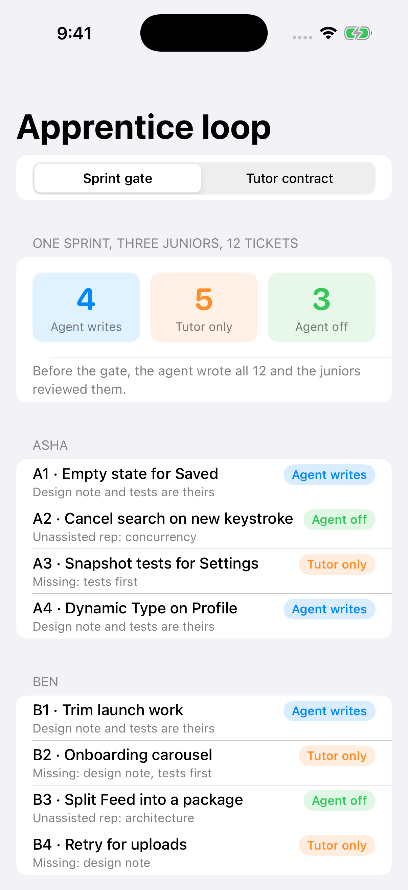
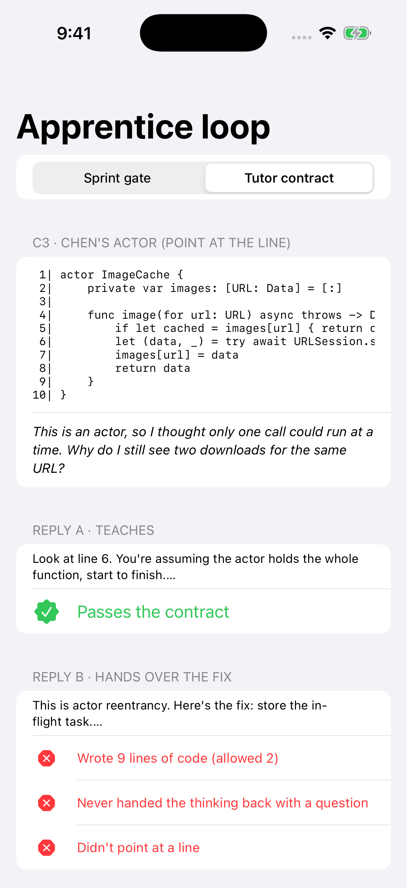

# ApprenticeLoop

**A delegation gate and tutor-mode contracts for teams where coding agents write most of the code, so juniors still get the reps that turn them into seniors.**

Article: [Coding Agents Are Producing Forever Juniors. Fixing That Is the Lead's Job.](https://medium.com/@er.rajatlakhina/coding-agents-are-producing-forever-juniors-fixing-that-is-the-leads-job-cc208cfe5320) (Medium)



## What it shows

If agents write the code and juniors only review it, the team stops producing seniors. This package writes three team rules down as code:

1. **The junior designs, the agent types.** `DelegationGate` lets an agent write a change only when the assignee has a design note and tests written first. Otherwise the agent may only tutor.
2. **Some tickets run with the agent off.** `ApprenticeshipPlan` takes each engineer's tickets in windows of four and marks the one in their lowest-rep skill (from a `SkillLedger`) as agent-off. The rotation is checked before evidence, so a quick design note can't skip a rep.
3. **Prompt the model as a tutor, then check the reply.** `TutorMode` has four prompt patterns (defend the diff, quiz me first, two designs, point at the line). Each has a `TutorContract` checked in code: a cap on code-looking lines, a question handed back to the learner, and, for "point at the line", a cited line that exists in the numbered source.

```swift
let gate = DelegationGate(agentOffTickets: plan.agentOffTickets(for: tickets, ledger: ledger).ids)
switch gate.decide(ticket) {
case .agentWrites: break                  // design note + tests are theirs
case .tutorOnly(let missing): print(missing) // agent may teach, not write
case .agentOff(let skill): print(skill)   // unassisted rep
}
```

```swift
let violations = TutorMode.pointAtLine.contract.check(reply: reply, sourceLineCount: 10)
// The sample "here's the fix" reply:
// [tooMuchCode(found: 9, allowed: 2), noQuestionForLearner, noLineCitation]
```



The sample sprint (three juniors, 12 tickets) gives 4 agent writes, 5 tutor only and 3 agent off. The names, tickets, ledger and model replies in `SampleScenario` are **constructed for illustration**, not data from a real team or a recorded model session. The tests assert every number above.

## How to run it

```bash
git clone https://github.com/rajatslakhina/forever-junior-article-demo.git
cd forever-junior-article-demo
open Demo.xcodeproj
```

Pick an iPhone simulator and press Build & Run. No other setup: the app consumes the library through a local package reference in this same repo.

Library only:

```bash
swift build
swift test
```

## Layout

| Path | What |
|---|---|
| `Sources/ApprenticeLoop/` | `DelegationGate`, `ApprenticeshipPlan`, `SkillLedger`, `TutorMode`, `TutorContract`, `SampleScenario` |
| `Tests/ApprenticeLoopTests/` | 17 tests, including edge cases (out-of-range citations, ties, empty input, short last window) |
| `Demo.xcodeproj`, `Demo/` | SwiftUI demo app (iOS 17+) |
| `Scripts/simulator-screenshots.sh` | Builds the app, launches it on a Simulator and captures `Demo/Screenshots/` |
| `.github/workflows/ci.yml` | `swift build -warnings-as-errors`, `swift test`, then the Simulator run on macOS |

## Verification status

- `swift build` (warnings as errors) and `swift test` (17 tests, 0 failures): run on Linux with Swift 6.1.2 before the first push, and on macOS in CI.
- Simulator: the app is built with `xcodebuild`, installed, launched and screenshotted on an iPhone Simulator by the CI workflow on a GitHub-hosted macOS runner. The job fails if the app isn't running after launch. The screenshots in `Demo/Screenshots/` are those captures.

## Credit

Prompted by Elise Baturone's [Forever Junior: The Skills AI Can't Develop For You](https://tech.criteo.com/blog/human-skills-ai-cant-develop-junior-engineers/) (Criteo Tech, 7 Oct 2026).

MIT licensed.
